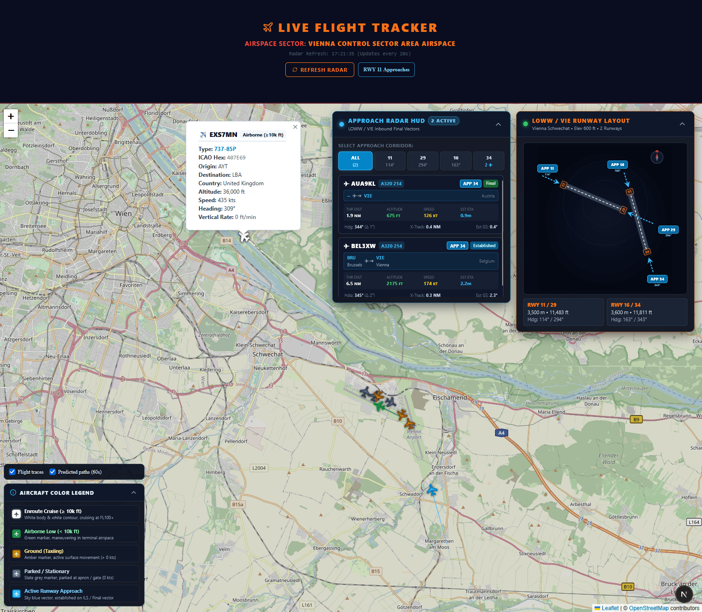
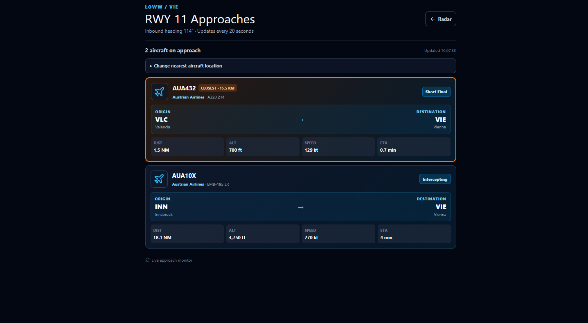

# Aircraft on Approach — Vienna Airspace Tracker & Approach Monitor

A high-performance, real-time flight tracking dashboard and runway approach monitoring system focused on the Vienna International Airport (ICAO: `LOWW` / IATA: `VIE`) terminal area.

The system combines live ADS-B state vectors from the OpenSky Network, automatic aircraft metadata resolution, offline regional map tile serving, and an in-browser geometric vector engine that tracks and calculates aircraft approach status across all active runways in real time without external API overhead.




---

## Key Features

### 1. Live Airspace Radar Map
- **High-Contrast Situational Awareness**: Muted, high-legibility map canvas with real-time aircraft markers color-coded by altitude and operational status:
  - ⚪ **High Altitude Enroute** (`≥ 10,000 ft`): Crisp white marker with dark border.
  - 🟢 **Low Altitude Airborne** (`< 10,000 ft`): High-visibility green marker.
  - 🟡 **Taxiing / Ground Movement** (`on_ground: true`, `speed > 0 kts`): Dark yellow marker.
  - 🔘 **Parked / Stationary** (`on_ground: true`, `speed == 0 kts`): Slate grey marker.
- **Detailed Flight Inspection Popups**: Interactive cards showing callsign, 24-bit ICAO hex address, resolved aircraft type/model, country of origin, altitude (ft), ground speed (kts), magnetic heading (°), and vertical rate (ft/min with climb/descent indicator).
- **Flight History & Prediction**: Toggleable aircraft traces and short-term predicted paths; moving aircraft markers are extrapolated between live data updates.
- **Aircraft Color Legend**: On-map legend explains the altitude, ground-movement, parked, and active-approach marker colors.

### 2. Real-Time Vector Approach Detection Engine
- **Orthogonal Vector Projection**: Projects aircraft positions mathematically along and across extended runway centerlines without third-party API dependencies.
- **Multi-Phase Approach Classification**:
  - `Short Final`: Along-track distance $\le 1.5\text{ NM}$, cross-track deviation $\le 0.4\text{ NM}$, heading alignment $\le 20^\circ$.
  - `Final`: Along-track distance $\le 6.0\text{ NM}$, cross-track deviation $\le 0.8\text{ NM}$, heading alignment $\le 25^\circ$.
  - `Established`: Intercepted final approach course with heading alignment $\le 35^\circ$ and cross-track error $\le 1.5\text{ NM}$.
  - `Intercepting`: Inbound vectoring towards localizer within terminal corridor limits.
- **Glideslope & False-Positive Rejection**:
  - Excludes grounded aircraft (preventing takeoff rolls and taxiing planes from locking onto approaches).
  - Excludes climbing aircraft (`vertical_rate > 200 ft/min`), differentiating departures and go-arounds from landing traffic.
  - Enforces 3-degree descent slope ceilings ($\le 5.5^\circ$ glide angle cutoff) to filter out high-altitude overflights crossing overhead.

### 3. Glassmorphism HUD Overlays
- **Runway Layout Visual HUD (Top-Right)**:
  - SVG schematic of east-offset, non-intersecting runways `11/29` (3,500 m) and `16/34` (3,600 m).
  - Threshold runway identifiers, magnetic bearings, extended approach paths, and compass North rose.
- **Approach Radar HUD (Top-Right)**:
  - Runway filter controls (`ALL`, `11`, `29`, `16`, `34`) with active aircraft count badges.
  - Inbound aircraft queue displaying callsign, aircraft type, origin and destination, distance to threshold (NM), altitude, speed, estimated time of arrival (ETA), and heading deviation.
  - Dedicated `/rwy11` approach list, linked from the dashboard and optimized for narrow displays, with a nearest-aircraft highlight configurable by coordinates and airline-colored aircraft illustrations for recognized callsigns.

### 4. Zero-Network Local Map Tile Cache
- Self-contained map serving via local raster tiles stored in `public/tiles/{z}/{x}/{y}.png` for zoom levels 10–13.
- Completely avoids recurring external map API calls and eliminates rate-limit blocks.
- Built-in tile downloader (`backend/download_tiles.py`) with automatic tile validation and mirror fallbacks.

---

## Architecture & Technology Stack

| Component | Technology | Description |
| :--- | :--- | :--- |
| **Frontend Framework** | Next.js 15 (React 19, TypeScript) | Responsive dashboard and state management |
| **Mapping Engine** | Leaflet / React-Leaflet | Canvas tile layer and dynamic rotated SVG aircraft markers |
| **Styling** | Tailwind CSS 4 & Custom CSS | Dark glassmorphism HUDs, crisp map filters, responsive overlays |
| **Backend API** | FastAPI (Python 3.10+) | Telemetry aggregation, unit conversions, and CORS middleware |
| **Live Telemetry** | OpenSky Network REST API | Real-time ADS-B state vectors within Vienna bounding box |
| **Metadata Resolution**| adsbdb / hexdb REST APIs | Parallel resolution of ICAO 24-bit addresses to aircraft model names |

---

## Project Structure

```text
aircraft-on-approach/
├── app/
│   ├── approachDetection.ts    # Geometric vector projection & approach detection engine
│   ├── ApproachHUD.tsx          # Collapsible approach queue HUD and runway filters
│   ├── globals.css              # Custom styling, tile brightness/contrast, glassmorphism
│   ├── layout.tsx               # Next.js root layout with metadata
│   ├── MapDisplay.tsx           # Dynamic client-side Leaflet radar map component
│   ├── page.tsx                 # Main application dashboard page
│   ├── RunwayLayout.tsx         # SVG runway schematic & approach vector HUD
│   └── types.ts                 # TypeScript data contracts (FlightState, ApproachFlight)
├── backend/
│   ├── download_tiles.py        # Tile cache generator with mirror fallbacks & validation
│   └── main.py                  # FastAPI telemetry backend with OpenSky integration & caching
├── public/
│   └── tiles/                   # Local cached OpenStreetMap raster tiles (zooms 10-13)
├── package.json                 # Next.js dependencies and scripts
├── tsconfig.json                # TypeScript compiler configuration
└── README.md                    # Project documentation
```

---

## Getting Started

### Prerequisites
- **Node.js**: v18.18.0 or higher
- **Python**: v3.10 or higher
- **Package Managers**: `npm` and `pip`

---

### Step 1: Install Frontend Dependencies
```powershell
npm install
```

### Step 2: Install Backend Dependencies
Ensure the required Python packages are installed:
```powershell
pip install fastapi uvicorn pydantic requests
```

---

### Step 3: Populate Local Map Tiles (Optional / Pre-cached)
The project includes pre-cached map tiles for zoom levels 10 to 13. If you wish to refresh or verify all 1,150 regional map tiles:
```powershell
python backend/download_tiles.py
```

---

### Step 4: Run the Application

#### Terminal 1 — Start the FastAPI Telemetry Backend
```powershell
python backend/main.py
```
*The backend API will start on `http://127.0.0.1:8000`.*

#### Terminal 2 — Start the Next.js Frontend Server
```powershell
npm run dev
```
*The frontend development server will initialize on `http://localhost:3000`.*

Open your browser and navigate to **`http://localhost:3000`** to access the radar dashboard.

---

## Production Build

To build and run the optimized production bundle:

```powershell
# Compile Next.js production build
npm run build

# Start production server
npm run start
```

---

## API Reference

### `GET /api/flights`

Fetches current flights within the configured airspace bounding box.

**Query Parameters (Optional):**
- `lat` (*float*): Center latitude (default: `48.15`)
- `lon` (*float*): Center longitude (default: `16.50`)
- `radius` (*float*): Latitude radius in degrees (default: `0.8`)

**Sample Response (`HTTP 200 OK`):**
```json
[
  {
    "icao24": "4401a2",
    "callsign": "AUA452",
    "origin_country": "Austria",
    "longitude": 16.5683,
    "latitude": 48.1102,
    "altitude": 2450.0,
    "on_ground": false,
    "velocity": 142.5,
    "heading": 294.0,
    "vertical_rate": -689.0,
    "aircraft_type": "Airbus A320-214"
  }
]
```

---

## Approach Geometry & Calculations

- **Coordinate Conversion**: Geographical lat/lon coordinates are converted to Cartesian kilometer vectors from the runway threshold using the equirectangular projection centered on the runway threshold:
  $$\Delta x = (\lambda_{\text{plane}} - \lambda_{\text{threshold}}) \times \cos\left(\frac{\phi_{\text{threshold}} \cdot \pi}{180}\right) \times 111.32$$
  $$\Delta y = (\phi_{\text{plane}} - \phi_{\text{threshold}}) \times 111.32$$
- **Along-Track & Cross-Track Projections**:
  $$\text{Along-Track (NM)} = \frac{-(\Delta x \sin \theta_{\text{rwy}} + \Delta y \cos \theta_{\text{rwy}})}{1.852}$$
  $$\text{Cross-Track (NM)} = \frac{\Delta x \cos \theta_{\text{rwy}} - \Delta y \sin \theta_{\text{rwy}}}{1.852}$$
- **Time to Threshold (ETA)**:
  $$\text{ETA (min)} = \left(\frac{\text{Along-Track (NM)}}{\text{Ground Speed (kts)}}\right) \times 60$$

---

## License
MIT License. OpenStreetMap data © [OpenStreetMap contributors](https://www.openstreetmap.org/copyright). Live flight telemetry provided by [OpenSky Network](https://opensky-network.org/).
